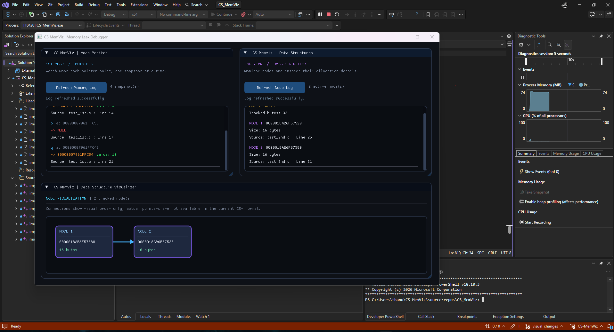
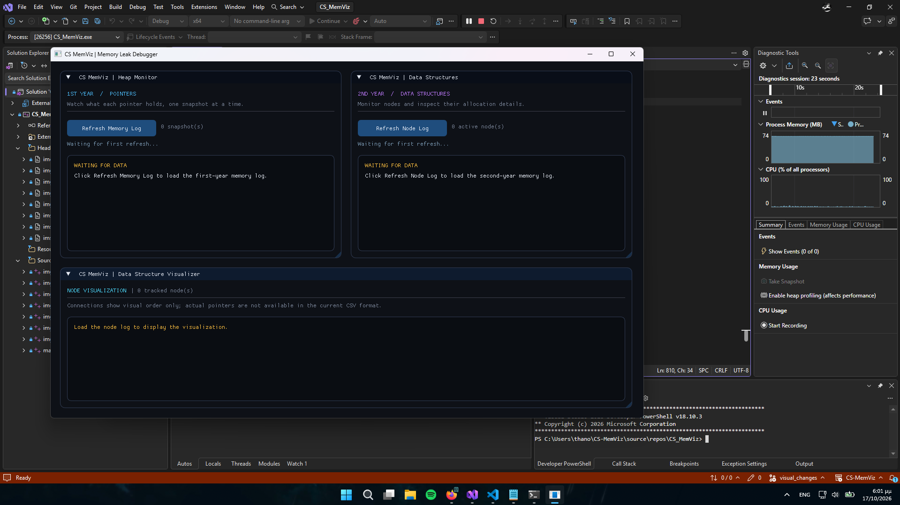

# CS-MemViz | Memory & Data Structure Visualizer 

**CS-MemViz** is an educational memory leak debugger and visualizer built specifically for computer science students. 

Goning from basic programming to pointers and dynamic data structures can be challenging. CS-MemViz bridges this gap by providing a real-time, visual representation of what is actually happening inside the heap. 

##  Features

The project is divided into two main tracking modules tailored to the university curriculum:

*   **1st Year (Pointers):** Tracks specific pointer variables, showing exactly what address they hold, what value lives at that address, and when they point to `NULL`.
*   **2nd Year (Data Structures):** Automatically intercepts `malloc` and `free` to track heap allocations. It detects memory leaks and visually maps out active Data Structure Nodes (like Linked Lists), showing their sizes and memory addresses.
*   **ImGui Visualizer:** A sleek, dark-mode graphical interface built with Dear ImGui and DirectX 11 that parses the tracker logs and renders the memory state on-screen.

---

##  How It Works

CS-MemViz operates using a two-part system:
1. **The Trackers (C Headers):** Students include a lightweight header file at the end of their includes. These headers use macros to override standard memory functions or track pointers, logging operations to a `.csv` file in the user's directory.
2. **The Visualizer (C++ App):** A standalone GUI application that reads the generated `.csv` files and translates them into an interactive visual dashboard.

---

##  Getting Started

### Prerequisites
* **OS:** Windows (The visualizer relies on Win32 API and DirectX 11).
* **Compiler:** Any C/C++ compiler (GCC, MSVC) for the student's code.

### 1. Using the Trackers in Student Code

#### First Year: Pointer Tracking
To take snapshots of a pointer's state, include `tracker1st.h` as the **last** include in your C file, and use the `TRACK_PTR()` macro.

```c
#include <stdio.h>
#include <stdlib.h>
#include "tracker1st.h" // MUST be the last include

int main() {
    int x = 10;
    int *p = &x;
    
    // Take a snapshot of pointer 'p'
    TRACK_PTR(p); 

    return 0;
}
```

### Second Year: Data Structures
To track **malloc** and **free** automatically, simply include `tracker2nd.h`as the **last** include. You do not need to change how you write your code, the tracker intercepts standard memory allocations behind the scenes.

```c
#include <stdio.h>
#include <stdlib.h>
#include "tracker2nd.h" // MUST be the last include

typedef struct Node {
    int data;
    struct Node *next;
} Node;

int main() {
    // This malloc is automatically tracked!
    Node *first_node = (Node *)malloc(sizeof(Node));
    first_node->data = 42;
    first_node->next = NULL;

    // Forgetting to free(first_node) will be caught by the visualizer
    return 0;
}
```


### 2. Running the Visualizer

Compile the Visualizer: Build the main C++ application. Ensure you have linked the required dependencies (ImGui, d3d11.lib, and dxgi.lib).

Run the Executable: Launch the compiled program.

Load Your Data: Click "Refresh Memory Log" (to view Year 1 pointer data) or "Refresh Node Log" (to view Year 2 allocation data). This loads the CSV files generated by your C code.

Visualize: Watch your memory map and data structure nodes update in real-time!

### Screenshots


*Visualizer in a working state.*


*Visualizer showing a memory leak.*
